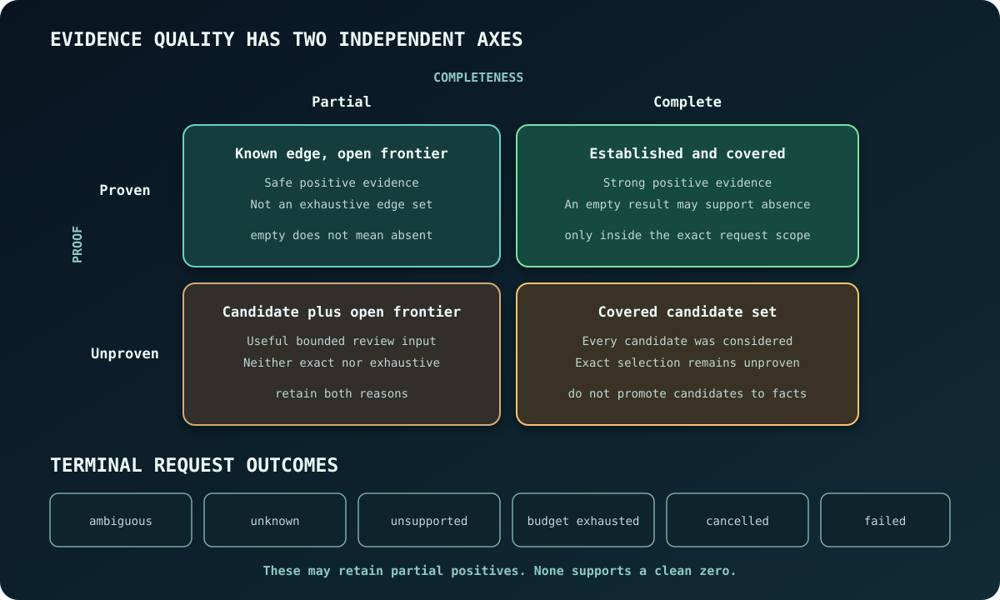

Bifrost results report both the evidence found and how much of the requested
search completed. A row can be useful positive evidence without proving that
the search was exhaustive. A completed search can return no rows and support a
bounded absence claim.

## Proof and completeness

Every semantic edge or relation carries two independent axes inside one public
`evidence` object. Optional `reason` carries the typed failure or limit that
explains an unproven or partial result:

| Field | Complete value | Limited value |
| --- | --- | --- |
| Proof | `proven` when retained evidence establishes the relation | `unproven` with a reason when the row is a structured candidate |
| Completeness | `complete` when evidence covers the requested semantics at that site | `partial` with a reason when a frontier remains |

Neither dimension implies the other. A proven edge can be one known edge in an
incomplete dispatch set. A complete candidate enumeration can contain an
unproven alternative when the available semantics cannot select one runtime
target.

When paths differ in proof or completeness, the solver keeps the incomparable
alternatives. It discards a path only when another path dominates its evidence.

A retained taint witness can establish finding certainty independently of
unrelated run-level gaps. Its proof still includes the source and sink
obligations: observing an argument at a call site does not discharge unresolved
dispatch required by that endpoint selector. Structural call syntax and declared
signature/formal mappings establish endpoints independently of callee execution.
Resolved-target or receiver-family selections retain an exact call obligation;
complete bindings or independently accepted, fully applicable summaries must
close those call obligations. A reviewed
summary used for endpoint dispatch retains its authored identity on the finding,
even when the witness stops before traversing a summary transfer.

Public renderers name the axes as `proof` and `completeness`; they do not mint a
third composite quality label. Cached policy unit rows retain the same evidence
object as direct, CLI, MCP, and LSP query results.

## Set identity and evaluation order

Set operations compare source or semantic row identities, not projected field
values. A union retains the first row for an identity in authored branch order
and merges later evidence and bounded provenance into it. A union may combine
branches of different row kinds when only filters and projections follow it:
rows of different kinds never share an identity, so each row keeps its kind and
the union keeps every branch's rows, and a consumer that admits rows by kind,
such as a match policy's terminal gate, admits every branch's kind or refuses
the plan. An intersection keeps
the first branch's surviving row and combines the other branches' evidence. A
difference keeps the first branch's rows whose identities the later branches
do not exclude. A survivor retains its own projected field mapping, even when
another branch exposes different native fields under a compatible public schema.

Filters above a union run after identity deduplication and evidence merging.
They cannot be distributed into its branches: filtering out the first
representative can expose a later row with a different payload or evidence.
This is true even when the branches publish identical schemas. Such a plan is
evaluated as a whole workspace query rather than merged from per-file units.
Project-only union suffixes remain eligible for per-file execution, as do
filters authored inside individual leaves before a union combines them.

## Request outcomes

At the provider boundary, outcomes remain typed:

| Outcome | Meaning | May contain useful data? | Supports a clean zero? |
| --- | --- | --- | --- |
| `complete` | The requested supported work completed under its stated scope | Yes | Yes, inside that exact scope |
| `ambiguous` | More than one structured candidate remains | Yes | No |
| `unknown` | The provider cannot establish the requested relation | Sometimes | No |
| `unsupported` | The selected capability is unavailable for this input | Sometimes | No |
| `unproven` | A structured result exists without sufficient proof | Yes | No |
| `exceeded_budget` | A named work limit stopped the request | Sometimes | No |
| `cancelled` | Cooperative cancellation stopped the request | Sometimes | No |

Policy and extension surfaces may use wire labels such as `frontier_bounded`,
`budget_bounded`, `inconclusive`, `not_run`, or `refused`. Those labels preserve
the same semantic distinctions. A transport error remains distinct from an
analysis outcome.

A policy report uses `not_run` when a selected policy cannot start because a
required workspace capability is unavailable. The record names the missing
capability and reason, and makes no absence claim. Selection provenance is part
of the outcome: an implicitly selected policy does not make the batch
unreliable, while an explicitly requested policy ID exits unreliable because
the request was not honored.

An exact qualified locator that cannot bind the pinned workspace or active
model set prevents a match, assertion or typestate policy from starting. Its
`not_run` record preserves the locator's typed reason and the fully validated
authored policy identity. That identity does not represent a resolved
executable policy, and the run publishes no cached evaluation evidence.

Taint and flow policies bind each endpoint entry independently. An unavailable
identity prevents only that entry from selecting sites; the remaining entries
run. Completion is inconclusive with partial discovery, and an incomplete-run
diagnostic names the entry's selector path, qualified identity and binding
reason. An unavailable sanitizer cannot select sites or suppress findings.
When every sink entry has an unavailable identity, the policy remains
`not_run`, because no sink can be checked. Invalid authored source, imports,
schemas and resource limits remain validation errors, including malformed
qualified identities.

Public semantic budget failures name a coarse lane: `source`, `rows`,
`retained_bytes`, `steps`, or `files`. The internal ledger can refine its
accounting without changing this vocabulary. In dispatch outcome rows,
`exceeded_limit` is optional: an unavailable lane does not turn budget exhaustion
into a complete result. Lane projection preserves the typed outcome, candidate
coverage, proof, and completeness.

## Scope is part of the claim

Completeness is scoped to the request that produced the result. Relevant scope
includes:

- workspace root and generation;
- selected languages, files, and path filters;
- operation and relation kinds;
- call depth and semantic frontier;
- active semantic-model set and dependency fingerprint;
- result, graph, source-byte, and traversal limits; and
- witness and provenance retention limits.

For example, a complete three-file search supports a three-file absence claim.
A procedure-local CFG query supports only that procedure-local claim.

Python formatting diagnostics identify the exact source site and relation whose
analysis is incomplete. A filter on a known relation identity can exclude gaps
belonging only to another relation. Filtering for an issue, proven evidence, or
complete rows cannot discharge an unknown. This relevance follows only a unique
chain of row filters and projections; set operations and other transformations
end that chain. Per-file execution preserves these authored boundaries when it
distributes union branches, so partitioning cannot manufacture completeness.

For Rust point resolution, an undecidable cfg on the selected reference site is
a premise of that lookup. The resolver assumes the site's unknown literals hold
while checking candidate declarations and marks a successful answer with a
`conditional_cfg` diagnostic. Candidate cfg alternatives that remain unknown
outside that premise can still make the lookup incomplete. A refuted site cfg
continues to produce an inactive result.
A gap produced at a declaration that is refuted for the reference does not make
the answer incomplete; the resolver discharges that gap by identity.

Completeness also follows the fields a consumer uses. An exact call binding
establishes which actual argument maps to which formal parameter; it need not
establish the conversion between their types. Binding rows report conversion
proof separately as `proven`, `unknown`, or `not_applicable`, with a typed reason
when unknown. A conversion-dependent field read preserves that unknown through
cached rows and relational evaluation. It cannot become an ordinary null that
proves absence. A selector that uses only the exact binding identity does not
inherit unrelated conversion uncertainty.

Rust call conversions use exact annotated types and selected bindings to prove
identity and supported builtin reference adjustments: dereferencing,
mutable-to-shared reborrowing, and array-reference-to-slice unsizing. These
adjustments retain operation provenance without asserting an identity-breaking
value conversion. Their proof concerns conversion typing, not borrow validity;
unresolved lifetime, generic, or user-defined coercion obligations stay unknown.

The same separation applies to Java flow: an exact argument mapping establishes
value dependence even when the conversion annotation is unknown. That does not
establish reference identity. Unknown conversions cannot transport heap aliases,
and proven unboxing retains its possible exceptional boundary.

## Coverage and its partition

Evidence answers whether a returned row is real. It says nothing about the rows
that are absent, and every absence claim -- an anti join, a zero count, a
`none` assertion -- reads exactly that second question. Coverage is the separate
axis that answers it, and it is always relative to a partition.

A query's own completion states coverage for the row set it returned. An
analysis that runs a solver states coverage for the partition that solver
enumerated: the value-flow plan, the typestate protocol, the taint sink, the
member-access class set, or the call site. The two are independent. A flow query
can return every endpoint it found while the solve behind them stopped against a
budget, so the returned set is whole and the partition is not.

Rows of those families therefore carry a coverage value beside their evidence
object:

| Extent | Meaning |
| --- | --- |
| `exhaustive` | Every row of the stated partition that exists was returned |
| `incomplete` | Rows of the partition may be missing, with the typed causes |
| `unsupported` | The producer cannot describe this partition at all |

Policy evaluation folds a relation's coverage by a meet: a derivation is exactly
as trustworthy as its weakest input, `exhaustive` adds no restriction, and
`unsupported` dominates. The folded value keeps the partition of whichever input
made it weaker, so an absence verdict that cannot be published names the solve
that left it open rather than reporting an unattributed incompleteness. Those
unmet obligations are canonical report data, not prose.

Coverage never invalidates a positive row. A count above an upper bound is
evidence the returned rows established, and unread rows could only raise it, so
that verdict publishes from a partition the solver did not finish. Only the
claim about rows nobody read requires an enumerated partition.

## Positive evidence and authoritative absence

A partial result supports only a narrow positive claim: Bifrost returned this
source-backed edge.

An empty result supports authoritative absence only when all relevant
conditions hold:

1. the request and transport succeeded;
2. the intended workspace generation was analyzed;
3. the capability was supported for every selected input;
4. execution completed without cancellation or a budget boundary;
5. every path selector the request named selected files that were searched;
6. result and provenance retention did not truncate the claim; and
7. the absence statement repeats the actual analysis scope.

Condition 5 is the selector half of the same rule. A path selector names a
file, a directory (with or without a trailing separator, selecting every file
beneath it), or a glob. A selector that names none of those searched nothing,
so the request covered less of the workspace than it asked for. Bifrost reports
that selector as written, marks the result incomplete, and reports absence as
unverified rather than proven.

## Provenance and source mapping

Stable identities support comparison, caching, and remapping of a semantic
subject. Source mappings let a person or client inspect why the subject or
relation was returned. Declaration identity remains independent of source
ranges.

Derived results can have several provenance paths. A bounded response may retain
only some of them, with omission status distinguishing one witness from an
exhaustive witness set.

### Effective configuration

Authored configuration facts and effective configuration are separate result
types. An authored fact says what one exact document snapshot contains. An
effective result says what wins after a caller supplies explicit layers,
profiles, includes, deployment overrides, placeholder expansions, or external
environment evidence together with their precedence relations.

The resolver never reads ambient process state, retrieves secrets, evaluates
expressions, or guesses framework bindings. Each contribution retains a stable
source identity and provider/version identity. Each precedence edge names the
lower and higher layer and the reason for that ordering. Structural keys omit
source ranges so the same key can correlate across files; the authored facts
retain the exact ranges as evidence.

Resolution is iterative and bounded by contribution and precedence-work limits.
A uniquely maximal contribution can provide useful positive evidence while a
missing include, unavailable environment, unknown profile, unresolved
interpolation, parser limitation, or other typed reason makes completeness
partial. Incomparable maximal contributions are a conflict even when their
opaque values have the same spelling: equality does not prove which source won.
Cancellation and either exhausted budget produce an unresolved proof rather
than fabricating a winner. Only a uniquely selected contribution with complete
evidence is an effective value claim.

### Code and configuration correlation

Programming code and configuration documents are distinct input domains.
Configuration formats are not programming languages, so ordinary composition
stays inside one domain: `intersect` and `except` refuse a code branch beside a
configuration branch, and `union` refuses rows it could not discriminate. A
policy relational `join` likewise refuses to pair code rows with configuration
rows by equal field values, because an equal spelling, path, or co-occurrence
in one repository is not evidence that two rows are related.

Code and configuration meet only through a registered cross-domain operator.
Each operator declares its typed inputs (one code domain and one configuration
domain) and publishes `cross_domain` rows whose required `domain` field
discriminates what the row carries. Both input rows keep their identities,
exact locations, and derivation provenance: the configuration fact whole, and
the code row as a typed reference to its own row family.

- `correlate` pairs a code row with a configuration fact only where a
  registered structural relation holds. The relation names its correlation
  key; a key may be a resolver-proven binding, an explicit framework-neutral
  mapping, or a declared file or module relation, never a name or text match.
- `require-both` checks that a code predicate and a configuration predicate
  are both satisfied. It returns each contributing row under its own domain
  and pairs nothing, so satisfying both predicates never implies that two rows
  are related.

The first registered relation, `configuration-key`, binds Java code to Java
`.properties` documents. Its correlation key has three structural parts. The
code row is an argument bound by a resolver-proven call to a formal parameter
of the accessor the query selects. The argument is a plain string literal,
decoded from the syntax tree. The configuration row is a member whose route is
exactly one key segment equal to that literal, inside a document the relation
declares by exact workspace-relative path. Declared documents are exact paths
because a glob would turn the declaration back into a same-repository join.
Nested routes in YAML, TOML, JSON, or XML need a framework's binding rules,
which belong to framework catalogs rather than to the general operator.

Absence keeps its usual discipline. A bound call that the resolver did not
prove, a key that is not a plain literal, code in a language without a key
decoder, and a declared document that is missing, outside the configuration
input's scope, or only partly recovered each produce a typed `incomplete`
diagnostic. An empty answer under any of them is not a clean negative. A key
that names more than one authored fact correlates with every candidate and
marks each row `ambiguous`: choosing the fact that wins is an
effective-configuration claim, not a correlation claim. Budget stops in either
input or in the operator itself truncate the result in the ordinary way.

`dependency-configuration` supplies a second registered relation. Its author
reviews an exact consuming topology identity and a complete bounded document
mapping, together with explicit override edges, supported dependency-version
ranges, and desired plain `.properties` values. The operator reads full
immutable document facts before filtering, resolves precedence through the
effective-configuration contract, and checks the same dependency row's exact
owner and version. It does not infer a runtime or framework binding.

The relation preserves a dependency witness when mitigation is unproved. Its
`mitigated` flag becomes true only for complete unique effective evidence and
supported same-instance applicability. Unknown configuration leaves the flag
false and retains typed diagnostics, so policies can preserve the recorded
affected instance without making an unsound absence claim. A different owner's
witness carries no unrelated configuration pair. Original dependency identity,
reviewed mapping identity, effective proof and contributor citations remain
available across transports.

A retained report identifies its artifacts, declarations, events, policies,
and sources before mapping them into the current presentation.

## Canonicalization across clients

Canonicalization happens before protocol-specific rendering. Equivalent LSP,
MCP, CLI, and library operations are expected to preserve result ordering,
identity, completion, diagnostics, and evidence. Adapters can map transport
errors or envelope fields. Canonical analysis execution and result
interpretation remain fixed.

Differential tests can compare that canonical payload across adapters
independently of transport timing and queue metadata.

## Cache consequence

Only complete, current artifacts are eligible for complete-value caches.
Cancelled, stale, budget-exhausted, store-failed, or semantically partial work
remains scoped to the request that produced it.

The storage chapter specifies the corresponding
[complete-value cache mechanics](../storage-and-cache/#complete-bounded-derived-values).

Operational wording is in [Agent Result Safety](/agent-result-safety/). The
identities and artifacts needed to replay a result are in
[Reproduce an Analysis](/reproduce-analysis/).
