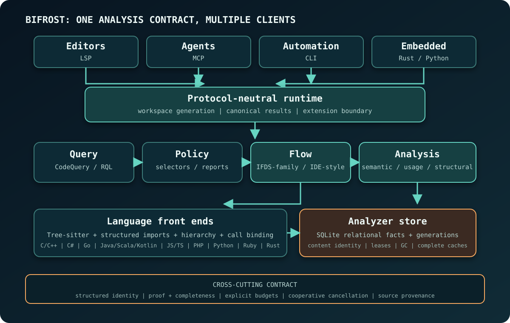

Editors, agents, CLI clients, and library callers use the same analysis runtime.
Transport stays at the outer edge; orchestration, language knowledge, semantic
engines, and durable storage sit behind it.

## Layer map

### Client and protocol layer

The CLI, Rust library, Python client, MCP server, and LSP server are entry
points. MCP is optimized for tool calls from agents; LSP is optimized for
editor navigation. Shared analysis services decide whether a graph edge is
proven and whether an empty result is complete.

The protocol-neutral runtime owns the shared code-intelligence operations and
their serializable extension boundary. Protocol hosts map requests,
cancellation, and errors onto that runtime. Canonical result data is produced
below the transport boundary, so equivalent operations have the same semantics
whether they arrive over JSON-RPC or MCP.

### Query and policy layer

Rune Query Language (RQL) is the single authoring syntax for the
canonical typed `CodeQuery` model. The RQL compiler produces a `CodeQuery`.
Canonical JSON is generated from a decoded `CodeQuery` and remains its stable machine-facing serialization: MCP clients can supply fields
inline, and `query_file` accepts saved `.rql` queries. Both paths reach the same
typed logical and physical planner. Rust embedders can also construct the model
directly. See
[Query Representations](/code-querying/#query-representations) for the detailed
trade-offs and execution surfaces.

Policies add versioned authoring, endpoint selection, finding construction,
completion rules, and report formats. A structural endpoint match selects a
source or sink. The dataflow executor establishes whether a path connects them.

### Flow layer

The flow crate owns language-neutral value-flow, taint, typestate, type-flow,
and reusable-summary clients. They reuse one bounded interprocedural
call/return engine while retaining separate domains and result contracts. A
taint class, typestate state, and inferred receiver class remain distinct types.

### Analysis layer

`brokk-bifrost-analysis` is the shared engine. It coordinates workspace
snapshots through the multi-analyzer and owns shared algorithms, structural
indexes, usage analysis, semantic lowering, CFG/ICFG construction, and the
bridge code that needs parsing.

Above it, each language family's analysis crate holds its adapter and support:
`brokk-bifrost-python-analysis`, `brokk-bifrost-rust-analysis`,
`brokk-bifrost-go-analysis`, `brokk-bifrost-cpp-analysis`,
`brokk-bifrost-csharp-analysis`, `brokk-bifrost-php-analysis`,
`brokk-bifrost-ruby-analysis`, `brokk-bifrost-js-ts-analysis` for JavaScript and
TypeScript, and `brokk-bifrost-jvm-analysis` for Java, Kotlin, and Scala. The
multi-analyzer routes each file through these adapters while presenting shared
capabilities to callers. `brokk-bifrost-tools` links all nine families into the
complete language table and provides the shared product tools.

### Core and language-knowledge layer

`brokk-bifrost-core` contains the shared domain model: project files,
languages, code units, structured names and identities, cancellation, compact
IDs, canonical hashing, and cache-database foundations. The language-knowledge
crates depend only on core among Bifrost crates: `brokk-bifrost-jvm`,
`brokk-bifrost-go`, `brokk-bifrost-rust`, `brokk-bifrost-cpp`,
`brokk-bifrost-python`, `brokk-bifrost-csharp`, `brokk-bifrost-php`,
`brokk-bifrost-ruby`, and `brokk-bifrost-js-ts`. They hold syntax helpers,
language rules, and vocabulary without depending on the analysis engine.

`brokk-bifrost-semantic` builds on core and language knowledge. It owns semantic
models and the vocabulary used by lowering; algorithms that need the engine
remain in `brokk-bifrost-analysis`.

Language rules stay in language crates because Java overload applicability,
Rust module routing, C++ macro-aware identity, and Ruby autoload visibility use
different semantics. Typed interfaces let them produce common evidence shapes.
The adapter and resolver boundary is defined in the
[front-end chapter](../identity-and-language-frontends/#shared-syntax-language-specific-semantics).

### Storage layer

`brokk-bifrost-store` owns the SQLite analyzer store and name resolution,
including their per-language modules. It depends on semantic, core, and the
language-knowledge crates and sits below the analysis engine. It persists
content-addressed, queryable facts and projects them through workspace-generation
views. It also stores the
complete acyclic class-set dimension of reusable procedure summaries as
normalized rows with exact dependency and read evidence. A serialized writer
and bounded reader pool allow writes and snapshot reads to proceed concurrently.
Other complete immutable derived values remain in memory within explicit byte
budgets. The storage chapter's
[analysis storage layers](../storage-and-cache/#analysis-storage-layers) define
the boundary between those durable, projected, and cached representations.

## Request lifecycle

A typical request follows this sequence:

1. The host binds the request to a workspace generation and cancellation
   token.
2. The query layer validates the operation, limits, and requested capability.
3. The analyzer selects durable facts and current source content by exact
   identity.
4. If the request needs deeper semantics, language adapters materialize
   immutable per-file semantic artifacts and a bounded interprocedural view.
5. A structural executor, usage resolver, or flow client computes evidence
   under the request budget.
6. The runtime canonicalizes results together with execution status, proof,
   completeness, diagnostics, and provenance.
7. The protocol adapter maps that result to its wire format and preserves its
   uncertainty and analysis boundaries.

The workspace generation associates each result with the exact source snapshot
used to compute it. The
[revisioned workspace projections](../storage-and-cache/#revisioned-workspace-projections)
section describes the read-side isolation mechanics.

## Representation lifetimes

| Representation | Typical lifetime | Why |
| --- | --- | --- |
| Parsed declarations and structural rows | Across processes and compatible worktrees | They are the reusable, queryable, content-addressed output of upfront workspace indexing. |
| File semantic artifact | Across requests while its full validity key matches | It is immutable but more expensive and memory-heavy than structural rows. |
| Bounded ICFG snapshot | One solve or retained result | Its dense IDs and expanded contexts are run-local. |
| Complete procedure summary | Across compatible solves within a bounded repository | Its stable semantic identity can replace re-analysis, but only for inputs covered by its validity key. |
| Finding/report | One exact policy, snapshot, and configuration identity | Presentation must refer to the evidence actually solved. |

*Upfront indexing* stops after publishing source-derived declarations and
structural relations. File semantic artifacts, bounded ICFGs, and solver state
are materialized on demand.
[Storage and Cache Strategy](../storage-and-cache/#content-addressed-relational-facts)
shows how those indexed facts are published and reused.

## Dependency boundaries

Dependencies point downward only. From the bottom up, the crate layers are:

- core and the language-knowledge crates hold shared types, syntax, language
  rules, and vocabulary;
- semantic holds semantic models and lowering vocabulary;
- store holds the SQLite analyzer store and name resolution;
- analysis holds the shared engine and parsing-dependent bridges;
- the nine language-family analysis crates hold adapters and support;
- tools links every language into the complete table and exposes product tools;
- flow depends on the semantic-provider contracts from analysis;
- RQL and policy build typed user-facing operations above analysis and flow;
- runtime composes the protocol-neutral product surface; and
- MCP and LSP remain hosts at the outer edge.

The layering keeps ownership explicit. A type belongs in core only if it needs
no analyzer, store, grammar, or language module.

## Local-first service boundary

The shipped service model is local: analysis runs against a client-approved
workspace root and reads local source. Unsaved or mid-refactor code remains
available to the analyzer, and source custody stays within the local trust
boundary. A remote multi-tenant service would require additional decisions
about authentication, resource isolation, cancellation, cache tenancy, and
version negotiation. That deployment model remains a research topic; the
current architecture assumes a local service boundary.

## Cross-cutting invariants

Every subsystem is expected to preserve the same invariants:

- exact identity is structured and source- or resolver-backed;
- source coordinates support identity claims; durable identity requires the
  structured subject behind those coordinates;
- partial positive evidence remains usable; absence claims require
  complete coverage;
- cancellation and budget exhaustion are terminal properties of that request;
- cache publication requires complete, current inputs;
- run-local dense IDs never escape as durable identities.

The [Evidence and Result Contract](../evidence-and-results/) shows how these
invariants appear at the client boundary.

## Policy coordinator: diff-base unit reuse

The policy coordinator evaluates the requested policies against a workspace
and, for `--diff-base`, a base revision. It applies the diff join, suppressions,
scope, and reporting after evaluation. Reuse must produce the same canonical
report and exit status as a fresh full evaluation. Execution timings, reuse
measurements, and work counters describe the run and are excluded from that
comparison; finding identities, ordering, evidence, diagnostics, completeness,
and obligations are included.

### Repeated assertion subjects

Within one serial policy batch, assertion policies with identical subject
queries can share a complete whole-workspace subject selection. Compatibility
requires the full canonical query, including captures, branch order and
execution controls, identical query limits, and the same immutable analyzer
and pinned semantic-model context. This boundary always has an unrestricted
AST selection. Each policy builds its own selected AST-id set and correlated
row-family session afterward; those products are not shared across policies.

The batch retains only selections with multiple consumers and bounds their
combined rows, evidence records and dependency keys by a retention weight.
Incomplete, diagnostic-bearing, cancelled or unattributed selections are not
reusable. Each consumer retains its original logical work charges and checks
cancellation independently. Captured dependency reads are replayed into the
active ledgers without transferring a producer's ledger to another policy.
The cache ends with the batch and does not change transactional diff-unit
publication, policy ordering, or the canonical report.

### Seed units and dependencies

A seed unit restricts a query's initial file enumeration to one file. It does
not restrict subsequent caller, import, dispatch, or other cross-file lookups.
The recorded inputs of the execution determine whether the unit remains valid.
The coordinator enumerates the current seeds on every run, so a newly matching
file enters evaluation even when an earlier unit returned no rows.

Only exhaustive, diagnostic-free units with complete dependency evidence may
replace full execution. The coordinator checks cumulative budgets after
merging. A failed proof widens the query to full execution.

### Ordered union composition

A full union visits branches in authored order and rows within each branch in
that branch's execution order. A repeated row key keeps its first value and
appends later provenance traces, retaining the first sixteen traces and the
truncation indication. These rules are observable in policy evidence and in
relational assertions that choose a representative row.

Branch order cannot be exchanged with seed-file order. In particular,
deduplicating all branches inside each file and then concatenating files can
choose a different first writer. Sorting the final findings cannot repair that
lost evidence.

Sliceable union trees therefore retain each leaf branch's contribution in each
file unit until the global merge. Each row carries its authored branch path in
both its public and detailed provenance. The merge orders contributions by
branch path, then seed-file order, then the leaf execution's row order. Only
then does it deduplicate keys. Item and detailed evidence move together.

The invariant is: for every row key, the merged value is the first value in
the full branch-major execution, and its provenance is the same bounded prefix
of that execution's trace sequence, with the same truncation indication. This
is the choice the implementation makes today; another reasonable choice of
representative value and bounded provenance prefix is acceptable (owner
decision 2026-10-30) as long as it is chosen deterministically (the run-to-run
contract in AGENTS.md), the provenance is truthful and bounded, the
truncation indication is carried, and incremental and full evaluation of the
same code agree.
Ordered union concatenation is associative, as is retaining a bounded prefix
while propagating truncation. Flattening nested unions without intervening
steps preserves this invariant, including when branches enumerate overlapping
files or only one branch's results change in an edited file.

The eligibility check requires union-only Set nodes with no pipeline suffix on
those nodes, supported leaf plans, and a common seed-file comparator. A suffix
after a Set would consume already-deduplicated rows and needs a separate proof;
intersection and difference are not distributive over arbitrary seed files.
These shapes remain Whole. Registration-dependent typestate, value-flow,
taint, and witness steps, and decorator-binding projections, also remain
Whole. Unions containing `absent_member` are also excluded: that operation
merges caller-root evidence into the value itself, which cannot be reproduced
by retaining a first value and appending provenance. Selector compilation that
consumes live selected-site lists retains its
existing whole-union path until it can use the same global composition.

### Budgets are part of the proof

Full union execution divides remaining scan and pipeline budgets among its
branches and may retry a starved branch. Exhaustive file units alone do not
prove that a full union would avoid starvation.

For a sliced union, cumulative scan and pipeline work must stay below the
smallest branch share implied by the union tree. The bound uses the maximum
product of sibling counts along a root-to-leaf path. This conservative test
proves that the full execution cannot enter a fair-share retry. Semantic lanes
are shared without this division and retain their ordinary cumulative checks.
Reaching a bound requires full execution, preserving its completion and
diagnostics rather than guessing which prefix it would return.
