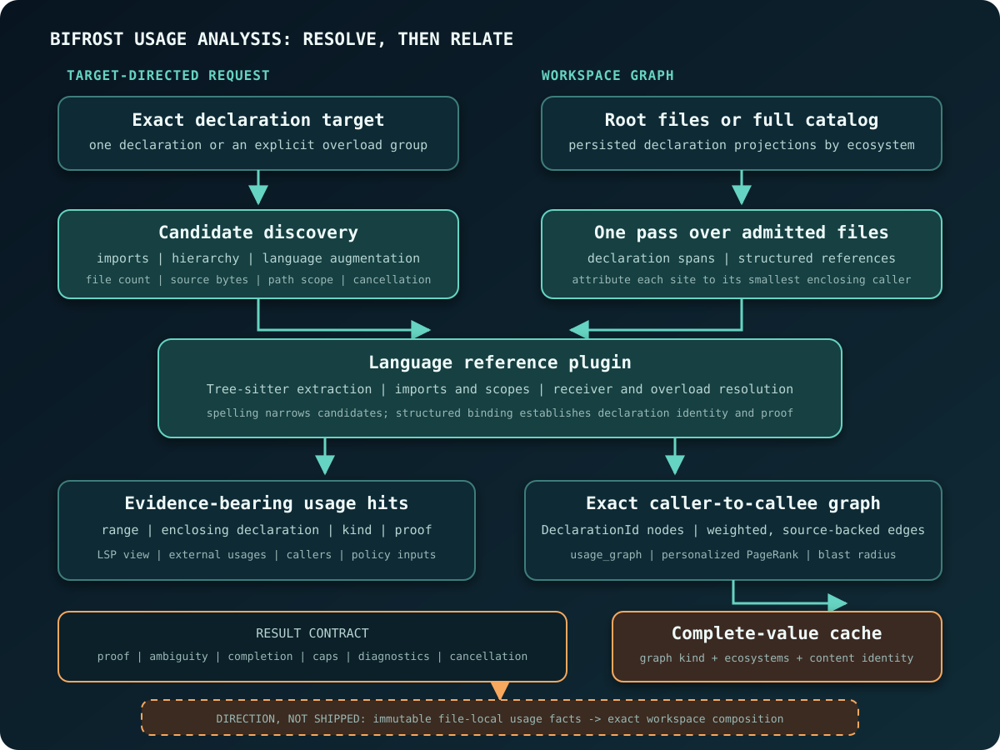

Usage analysis answers where a declaration is used. For each occurrence, it
binds the occurrence to a declaration using the language's resolution rules,
records the evidence for that binding, and reports the scope that the request
examined.

Bifrost uses those same rules for target-directed reference queries and bulk
caller-to-callee graphs. An interactive lookup narrows toward its target. A
bulk build processes admitted files and accumulates graph products.

## Reference queries and workspace graphs

| Workload | Starts from | Optimized for | Primary result |
| --- | --- | --- | --- |
| Target-directed references | One exact declaration or an explicit overload group | Editor references, agent navigation, callers, and focused policy work | Source hits grouped by target, with kind and proof |
| Workspace usage graph | Root files or the complete declaration catalog | Code maps, relevance ranking, blast radius, graph export, and bulk dead-code evidence | Exact declaration nodes and weighted caller-to-callee edges |

## Target-directed pipeline

### 1. Establish the target

The public selector resolves before the reference engine starts. The engine
receives either a declaration-backed `CodeUnit` or a group of
declarations that one source reference may legitimately name. Overloads and
duplicate declarations remain separate candidates. The engine scans every
candidate and unions proven hits by source site. At a site where candidates
disagree on proof, it retains the proven reading.

Name collisions are common in vendored trees, generated/source pairs, overload
sets, and multi-module workspaces. A reference stays visible when any candidate
in the target group can prove it.

### 2. Discover candidate files

Candidate discovery favors coverage because an omitted file can conceal a real
reference. The generic path follows structured import reachability, includes the
target's defining context, and expands type hierarchies where polymorphism
applies. A language plugin can add files required by its module, autoload,
re-export, include, or visibility rules.

The request then applies its path and test-file scope. Independent file-count
and source-byte limits control admission. When one limit forces truncation, core
candidates are protected before supplemental expansion. Cancellation is checked
throughout discovery and again during the file scan.

A budget is part of the request's semantics. If it suppresses any file planned
by discovery, the result is incomplete even when every admitted file was
resolved exactly.

### 3. Extract structured sites and resolve them

The registry selects one reference plugin for the target's language. That plugin
owns language-specific meaning: imports, local bindings, namespaces, receiver
types, inheritance, overload applicability, constructors, macros, and dynamic
forms. Shared orchestration owns traversal, budgets, cancellation, and the
common result contract.

Plugins begin with Tree-sitter structure and indexed declarations. Resolution
succeeds when the language resolver binds a structured reference candidate to a
declaration identity. A best-effort binding remains unproven, and an unsupported
operation or missing graph seed produces a typed diagnostic.

Rust method searches may exclude ordinary field-access sites before resolving
their receivers when source structure and provenance prove that those sites
cannot name the method. Uncertainty about such a field's binding does not make
the method search incomplete. This exclusion does not apply to speculative
macro input or malformed syntax, and it does not remove independent gaps in
the original file inventory. Resolving a guessed macro argument to a field
does not prove that its unrepresented expansion cannot call the method; that
uncertainty remains visible. Qualified references to method values remain
candidates even when they are not calls.

### 4. Publish hits with their roles

A usage hit carries its file, byte range, line, enclosing declaration,
reference classification, proof, and presentation snippet. It also carries a
semantic role: ordinary reference, import, re-export, self receiver,
declared-contract reference, definition, or override declaration.

Consumers select the roles appropriate to their surface. Editor
find-references includes binding and self-reference sites for navigation;
external usage and relevance surfaces omit them. Call-graph surfaces omit
self-receiver sites unless the caller requests `include_same_owner`; even then,
self-loops remain excluded. Classification
happens once, so every surface uses the same resolution rules.

## Selected graph caller admission

Native graph admission is separate from reference resolution. For every requested
caller, the shared driver records either an admitted resolution unit or an explicit
skipped classification. Admitted and skipped files are disjoint and together cover
the exact requested caller set, including empty files. That evidence survives unit
staging, projection, and graph aggregation; a skipped file does not erase the graph
assembled from admitted callers.

The native Go graph covers the selected Go-tool profile. Its package-context
publication records `IgnoredGoFiles` as `ignored`-role package memberships. These
rows are evidence of deliberate build exclusion, never semantic candidates, unit
members, import sources, reverse-reference sites, or rename targets. A change to
this publication contract advances the Go context derivation version so retained
contexts acquire the new evidence.

Tool-reported package-relative and absolute member paths are normalized before
source lookup, including Windows separator and prefix variants. Membership uses
path components relative to the package directory and workspace root; SQLite
keys join relative components with `/`. Aliases of one source are deduplicated,
with ignored evidence taking precedence over ordinary membership.

Go admission distinguishes three skipped outcomes. `excluded_build_selection`
means the tool explicitly ignored the file for this build; it is a structured
`file_notes` entry and does not make the graph incomplete. `outside_selected_modules`
means source inventory places the file in a module whose packages are absent from
the selected tool context; the product preserves a note for each file and one
incomplete reason per module import path. Acquiring those modules as independently
selected contexts is tracked by #5664. `unplaced` means no supported placement is
available; the product records one incomplete reason per file. Missing caller
authority cannot prove that any declaration has no inbound references. A missing
selected context itself remains a whole-operation failure.

A Go source that source admission refused does not make the Go inventory
unavailable. The selected revision records it with its reason, the tool context
gives each package that compiles it a `source_admission_refused` gap, and the
graph reports one `source_admission_refused` incomplete reason per refused file.
Like a missing caller, a refused file cannot prove the absence of inbound
references, so dead-code evidence over a workspace with one stays inconclusive.

Configured Go target settings are carried unchanged through session activation,
discovery, the Go runner environment, and the selected profile digest. They take
precedence over the host target. If discovery is disabled or fails, the graph
uses source-inventory placements and emits one `build_selection_unavailable`
reason with a `discovery_error` field. Filename GOOS/GOARCH suffixes and nested
module boundaries still prove exclusions; build-directive evaluation remains
unavailable. Admitted inventory files therefore cannot certify whole-graph
completeness or absence of inbound references.

Rust retains its existing treatment of files outside selected crates: an explicit
admitted unit resolves them with an empty crate-key context. The shared admission
contract does not require a language to discard structured resolution that it can
already perform for such files.

## Exact identity across languages

Workspace graph nodes are keyed by an exact `DeclarationId`, with the ecosystem
and file scope retained where needed to interpret it. A fully qualified name,
language label, path, signature, and range are descriptive fields on that node.

An ecosystem is the candidate universe in which a reference is resolved. Java,
Scala, and Kotlin share a JVM ecosystem because their declarations can meet on
one classpath. JavaScript and TypeScript share a module ecosystem. Each language
and declaration still has its own identity, and in module-scoped ecosystems the
defining file separates equal export names from unrelated files.

During a bulk scan, a resolver retains the exact target declaration beside the
source span before display-oriented aggregation. An edge is published after both
caller and callee hydrate to graph nodes. Fields, modules, and macros can appear
in focused reference analysis; the public workspace graph uses classes and
callables as its ranking nodes.

Scala's source usage graph attributes to authored declarations. Generated
companion owners are excluded at the graph's declaration read boundaries using
the stored synthetic provenance and structured companion kind. Written
anonymous templates and primary constructors remain graph declarations.
Generated member facts already use the source constructor's declaration rather
than creating another usage identity. Definition lookup can still resolve an
explicit generated apply to that constructor. Filtering at the read boundary
preserves the graph's context rules, including the distinction between an
allowed method value and an ordinary argument occurrence; normalizing a
synthetic owner after resolution would let earlier owner branches consume the
reference before those context rules run. The projection filters each query's
already-read collections in place and retains no additional index or cache.

## Proof and completeness dimensions

Usage analysis applies the
[shared outcome vocabulary](../identity-and-language-frontends/#proof-ambiguity-and-completeness)
to five domain-specific dimensions:

| Dimension | Examples | What it means |
| --- | --- | --- |
| Target selection | success, ambiguous, failure | Whether the requested declaration or declaration group was established |
| Per-site proof | proven, unproven | Whether structured resolution established this particular edge |
| Request completion | complete, cancelled, candidate-file budget exhausted, source-byte budget exhausted | Whether the planned file scope was fully processed |
| Output bound | complete enumeration, too many call sites with a sample | Whether every admitted site could be returned |
| Bulk-graph coverage | complete, truncated inbound, unproven inbound, incomplete reason | Whether a node's incoming graph evidence is exhaustive and exact |

The
[Evidence and Result Contract](../evidence-and-results/#positive-evidence-and-authoritative-absence)
defines the general rule. For usage analysis, a complete file scan can contain
unproven sites, and one proven edge says nothing about unexamined inbound edges.

A call-site cap leaves the hot symbol in the bulk graph's node catalog and marks
omitted inbound edges as truncated. A client can then narrow the request and
retry.

### Bounded gaps for reachability consumers

Some consumers walk the usage graph backwards and need a superset of the true
callers of every node, not a ranking. Test selection is the main example: it
starts at a changed function and walks callee-to-caller edges until it reaches
test functions. A missing caller hides a test. For these consumers, the Rust
graph reports what it cannot resolve in a bounded, structured form. One
unreadable site never makes the whole pass unusable.

The graph reports four kinds of evidence:

- Drawn edges, each marked proven or unproven. An unproven edge is still a
  possible caller, so a superset consumer follows it.
- Withheld references. Each one pairs the enclosing caller with either the
  reference's terminal name, when the resolver did not close the target set, or
  a known target whose edge was not drawn. The name comes from the lowering's
  identifier facts, never from source text at a byte range. A consumer adds a
  candidate edge from the caller to every node with that name, or to the target.
  The graph reports separately whether every withheld reference could be named;
  when one could not, that pass gives no evidence of absence.
- An implicit-caller flag. It marks a method of an `impl Trait for Type` block
  where `Trait` does not resolve to a workspace trait, and names the impl's self
  type. Code outside the workspace can call such a method with no call site in
  the workspace: compiler-inserted calls for operators, `Drop`, auto-deref and
  formatting, derive output, and standard-library generic code such as `sort`
  or `BTreeMap`. A consumer falls back to the callers of the self type, on the
  reasoning that code calling `Prerelease::cmp` must hold a `Prerelease` value
  and so must reach a declaration that names that type.
- An `implements` link from a method of a workspace-trait impl to the trait
  method it implements. Calls through the trait, for example from a generic
  `T: Trait` parameter, reach only the trait method's node, so a backward walk
  continues from the linked trait method.

Self-receiver calls are real calls between two methods, so a reachability
consumer requests them with `include_same_owner`, as described in
[Publish hits with their roles](#4-publish-hits-with-their-roles).

The graph does not draw edges for the calls Rust inserts implicitly, and it
does not expand derive output. Those edges would point only at methods of
external traits. Such methods keep the implicit-caller flag in any case,
because standard-library generic code can call them on workspace types without
any workspace call site. Under the self-type fallback the extra edges would not
change which callers a consumer selects. A more precise answer would need
summaries of calls that escape into external generic code.

## Workspace graph and relevance ranking

The bulk engine makes one pass over admitted files. For each file it creates a
declaration index, reads or parses prepared syntax, resolves structured
references, and records distinct sites by file, line, and enclosing caller.
Per-file products merge deterministically into weighted caller-to-callee edges.
Source trees can then be released after edge construction.

Bifrost has two ranking graph shapes:

- The coarse file graph uses structured direct file dependencies. It avoids
  exact receiver and overload resolution and is the lower-cost relevance path.
- The exact graph uses declaration nodes and resolved reference-kind weights.
  It supports a more precise but more expensive ranking and the public usage
  graph surface.

Personalized weighted PageRank propagates mass from the requested seed files
through the selected graph. Reference kinds can carry different calibrated
weights, and node scores are aggregated back to files. The score expresses
relevance over analyzer evidence, without modeling execution order or general
semantic importance.

### Complete-value graph cache

Workspace ranking graphs are snapshot-owned derived values. Their keys include
the representation version, graph kind, selected language ecosystems, and
content identity for exactly those ecosystems. An unrelated ecosystem edit
leaves the key valid; an in-scope edit changes it.

The graph follows the shared
[complete-value cache contract](../storage-and-cache/#complete-bounded-derived-values):
same-key work is single-flight, only complete values publish, and an oversized
complete graph may be returned without retention. Its graph-specific guard
rechecks content identity at publication. An update racing the build then leaves
the completed graph unpublished.

## Persisted inputs and compositional usage facts

> **Current:** Rust and Go target-directed references resolve through the
> [Name Resolution Engine](../name-resolution/), which stores immutable
> file-local facts by content identity and composes them with build-unit
> context in each query. Go's rooted and whole-workspace graphs use the same
> native engine. Other languages persist declaration and identifier
> projections, own language-specific indexes and prepared facts, and build
> target-directed or bulk usage products on demand. Only complete workspace
> ranking graphs are retained under exact content keys.

Languages other than Rust and Go assemble workspace graphs by revisiting their
resolution process. Some analyzers cache or persist file-derived inputs, and the
declaration catalog reads persisted summary projections.

> **Direction:** move every language onto the name resolution engine, so that
> immutable file-local facts are the common production boundary and workspace
> graphs are composed from those facts plus the exact workspace manifest and
> build configuration.

The [Decisions and Outlook](../decisions-and-outlook/#compose-immutable-usage-facts)
entry is the roadmap-level summary. The related
[compositional resolution fragments](../storage-and-cache/#compositional-resolution-fragments)
section covers what is stored and what is recomputed per query.

The engine meets these requirements for Rust and Go, and each language that moves onto
it must meet them too:

1. A source blob and extraction-semantics version identify an immutable local
   fact set: structured occurrences, enclosing declarations, imports, and
   language-owned binding inputs.
2. A workspace composer resolves cross-file identities against the current
   manifest, dependency fingerprints, configuration, and ecosystem rules.
3. An edit replaces facts only for changed content, then recomposes the
   affected dependency frontier.
4. Proof, ambiguity, omitted scope, and provenance remain fields of the
   composition. Cached facts retain their original proof and completeness.

Safe composition depends on complete dependency identity. Import aliases,
conditional includes, macro environments, inheritance, package graphs, and
dynamic receiver evidence can all affect what a fact means. A compositional
design must identify each dependency precisely and decline reuse when it cannot.
Each consumer has one selected authority. During a staged rollout, a language's
remaining incumbent consumers keep their existing resolver until their own
cutover; native consumers do not fall back to it.

## Boundaries and evaluation

The documented scope excludes compiler-complete dynamic dispatch, runtime call
frequency, whole-program points-to, and complete external-library indexing.
Language-specific unsupported forms, open dispatch, budget exhaustion, and
unresolved receiver evidence remain visible in the result.

For user-facing coverage, see [Language and Analysis Capabilities](/capabilities/).
For safe interpretation of zero or partial results, see
[Agent Result Safety](/agent-result-safety/).

[UsageBench](https://usagebench.brokk.ai/) provides versioned,
analyzer-neutral evaluation of symbol usage and reverse navigation. Its
published and development populations remain separate. The
[Evidence and Evaluation Methodology](/evaluation-evidence/) page defines the
claims that those results can support.
